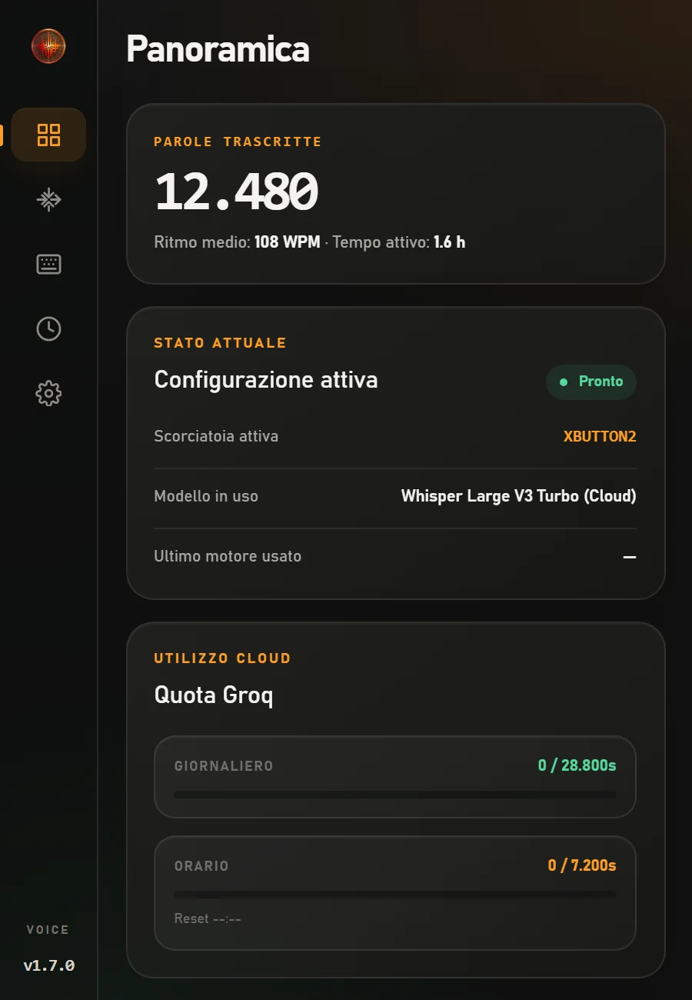

<h1 align="center">Traflix Voice</h1>

<p align="center">
  <strong>Voice dictation for Windows and Android.</strong><br/>
  Transcribe speech and deliver the result to the active editor.
</p>

<p align="center">
  
  
  
  
  
  
</p>

<p align="center">
  <a href="#features">Features</a> ·
  <a href="#supported-workflow">Workflow</a> ·
  <a href="#installation">Installation</a> ·
  <a href="docs/releasing.md">Release guide</a> ·
  <a href="docs/">Documentation</a> ·
  <a href="LICENSE">MIT License</a>
</p>

<p align="center">
  
</p>

Traflix Voice has two platform surfaces built from a shared product contract:
the Windows desktop app is local-first with optional Groq Cloud transcription,
while Android provides a Groq-powered keyboard and a separate local
transcription route for audio shared from other apps.

## Platforms

### Windows desktop

The desktop application uses Tauri 2, Rust, React, TypeScript, and a Python
sidecar. It captures speech globally and pastes the result into the focused
Windows application.

- **Global hotkey**: XBUTTON2 (forward mouse button) by default,
  click-to-toggle or hold-to-speak; a secondary shortcut, model, language,
  and microphone are configurable in the app.
- **Two transcription providers**: local Parakeet Ultra (private and on-device,
  with automatic Vulkan/GGUF GPU or native GGUF CPU inference) or Groq Cloud
  (`whisper-large-v3-turbo`, needs an API key in System settings).
  The Home tab always shows which engine produced the last dictation.
- **Keep ready microphone** on desktop: cloud and local dictation share an open
  microphone with 450 ms of in-memory pre-roll. Idle audio is neither saved nor
  uploaded. Select **Chiudi quando inattivo** in System to release it between clips.
- **Local model management** (AI tab): one-click Parakeet Ultra download
  (~740 MB on CPU or GPU), a resident model for rapid dictation, and
  **Libera RAM** to unload it from memory without deleting files.
  Switching to Cloud unloads the model automatically.
- **Delivery**: automatic paste (Ctrl+V) into the focused application, with
  the transcript left on the clipboard so you can paste it again with Ctrl+V
  if you miss it (disable this in **System** to restore the previous clipboard
  content instead), plus an always-on-top status overlay, system-tray
  access with minimize-to-tray, live waveform, local history (last 50),
  word statistics, and Groq quota meters.
- **Storage**: settings, history, statistics, usage, and downloaded models
  live in the OS application-data directory (`%APPDATA%\it.traflix.voice`).

### Android preview

The Android port is maintained on the
[`main`](https://github.com/iTzFrancesco/Traflix-Voice/tree/main)
branch. It provides a native Traflix Voice keyboard with hold-to-speak or
toggle recording and Groq Cloud transcription, encrypted API-key persistence,
and an overview/settings/history Hub. A **Trascrivi** page also lets users choose
an audio file with Android's system picker and get a local transcript in the
same mobile interface. The app registers as an audio share target too: choose
**Condividi** on an audio file in WhatsApp or another app, then select
**Traflix Voice · Trascrivi audio**. Both routes use the shared on-device Google
ML Kit Speech Recognition service; the result is saved in local history. The
share route opens a compact floating panel over the source app, starts
transcription automatically, and keeps the result visible there. It tries Basic
mode first, then Advanced mode if Basic is unavailable and the device supports
it. Neither local route falls back to Groq, and neither changes the original
Groq-powered keyboard path. Android still requires a voice note to be shared
from WhatsApp; the app cannot intercept taps inside WhatsApp. The Hub
checks GitHub for newer Android
releases after startup and only considers the `android-vX.Y.Z` tag family and
the signed `app-universal-release.apk` asset; Windows releases are ignored. A
newer mobile release is downloaded, verified, and sent to the Android installer
automatically. With the optional Accessibility service enabled, the compact
control stays available over other apps while the Hub task remains open. It is
hidden when the screen turns off or the device is locked, then returns after
unlock. Closing the Hub task cancels active capture, pending transcription, and
the recording notification.

The Android port is currently a private preview. Read the
[Android architecture plan](docs/android-architecture-plan.md) and the
[production-readiness checklist](docs/android-merge-readiness.md) for the supported
mobile boundaries. The current [Android preview release](https://github.com/iTzFrancesco/Traflix-Voice/releases/tag/android-v0.1.34)
contains the installable signed APK. Never distribute an `*-unsigned.apk`;
Android requires a signed APK for direct installation.

## Features

- Local Parakeet Ultra uses the same pinned `transcribe.cpp` GGUF Q8 model on CPU and GPU, with automatic device selection and CPU retry if GPU inference fails.
- Optional Groq transcription using `whisper-large-v3-turbo`.
- Configurable global hotkeys, click-to-toggle, and hold-to-speak recording.
- Automatic paste into the focused application, keeping the transcript on the
  clipboard so it can be pasted again manually.
- One-click Parakeet download from Hugging Face, manual RAM release ("Libera RAM"), and a Home indicator showing which engine produced the last dictation.
- CPU and optional CUDA device selection.
- Live waveform, always-on-top status overlay, and system-tray access.
- Local history and usage statistics.
- Multiple languages with automatic language detection.

## Supported workflow

### Windows desktop

1. Start the application and select a microphone in **System**.
2. In **AI**, download Parakeet Ultra for local dictation,
   or enable Groq Cloud mode (paste your API key in **System** first).
   Add the names and technical terms you dictate most often to the personal
   vocabulary in **AI** so cloud transcription spells them consistently.
3. Press the configured hotkey, wait for the overlay's listening signal,
   then speak; audio spoken before the microphone opens cannot be recovered.
   The overlay shows live status.
4. Press it again to stop, pausing briefly after your last word so the final
   syllable is captured. The transcription is pasted into the focused
   application and saved to history with word count and timing. It also stays
   on the clipboard, so if you miss it you can paste it again with Ctrl+V.
5. Check **Home** to confirm which engine (Locale/Cloud) ran last; use
   **Libera RAM** in **AI** to release the loaded model.

### Android

1. Build and sign an Android preview from `main`, or install the signed APK
   from the current Android release.
2. Open the Hub, configure Groq Cloud once, grant microphone access, and
   enable/select **Traflix Voice Keyboard** in Android settings.
3. To use the floating control, open **System** in the Hub, tap **Widget sopra
   le app**, and enable the Accessibility service in Android settings.
4. In any supported text field, choose Hold to Speak or Toggle in the Hub.
5. Press the Traflix microphone key. The transcript is committed through the
   active `InputConnection` and local history remains on the device.
6. To transcribe an existing voice note, use WhatsApp's **Condividi** action
   and select **Traflix Voice · Trascrivi audio**. A floating panel appears over
   WhatsApp and begins transcription automatically. With **Rilevamento
   automatico** selected, it uses the phone's language because the model needs
   a fixed locale.
7. To choose a file manually, open **Trascrivi** in the Hub, select an audio
   file, then tap **Trascrivi sul dispositivo**. The transcript appears there
   and is also added to local history.

Windows 10 and Windows 11 are the supported desktop platforms. Android 13+
is the target for the private mobile preview. macOS and Linux are not
currently validated. Desktop local transcription requires a downloaded model.
Android keyboard dictation uses Groq Cloud. Shared audio can use local ML Kit
transcription on Android 12/API 31 and later. ML Kit Speech Recognition is an
alpha API; Basic Italian is marked beta by Google, and Advanced mode is limited
to compatible phones. The first model preparation may need internet access.

## Installation

### Windows desktop

Prerequisites: Node.js 24, Python 3.12, a stable Rust toolchain, and the
Microsoft Edge WebView2 Runtime.

```powershell
git clone https://github.com/iTzFrancesco/Traflix-Voice.git
cd Traflix-Voice
npm ci
python -m pip install -r src-tauri/requirements.txt
npm run tauri dev
```

On first use, open **AI** and download Parakeet Ultra (~740 MB GGUF). Windows packages use the same pinned model on CPU and GPU, selecting the available backend automatically. If GPU inference fails, the same recording is retried on CPU. Once Ultra passes checksum verification and a real helper warmup, the app removes its previous Parakeet v3 model directory. RAM and GPU memory depend on the backend and clip length. Use **Libera RAM** to unload the model without deleting it. See [native transcription](docs/native-transcription.md) for build instructions and memory measurement.

### Android preview

The Android implementation is maintained on
[`main`](https://github.com/iTzFrancesco/Traflix-Voice/tree/main). Build and
signing instructions are in
[Android release readiness](docs/android-merge-readiness.md). A release APK must
be signed; files ending in `-unsigned.apk` are build intermediates and are not
valid direct-install packages. The current preview can be downloaded from the
[Android v0.1.34 release](https://github.com/iTzFrancesco/Traflix-Voice/releases/tag/android-v0.1.34).

The mobile updater checks for a newer Android tag after the Hub opens and on
return from the installer permission screen. It downloads only the expected APK
asset, verifies its SHA-256 and device ABI, and opens Android’s package installer
automatically. Android still requires the user to confirm the update and, on
some devices, allow installs from this app.

The desktop app checks GitHub’s latest stable PC release (`v*`) at startup and
when it returns to the foreground. Automatic checks run at most once every six
hours. Use the refresh button above the sidebar version to check at any time.
When an update is available, choose **Scarica aggiornamento**, then choose
**Installa e riavvia** after the download finishes. Installation waits until
dictation ends. Android prereleases (`android-v*`) are kept out of the desktop
update channel. The desktop release workflow publishes the signed MSI installer
and its `latest.json` manifest.
The stable `latest.json` release asset is also available to other integrations;
it includes the Tauri `windows-x86_64` target and the `windows-x86_64-msi` alias.

## Development and testing

Read the [release guide](docs/releasing.md) before changing versions, pushing
release tags, or publishing Windows or Android builds. Normal code pushes and
versioned releases use different GitHub Actions workflows.

```powershell
npm run build
python -m pytest src-tauri/test_*.py -v
cd src-tauri
cargo fmt --check
cargo clippy -- -D warnings
cargo test
```

For Android, also build the configured target with the Android SDK/NDK and a
keystore kept outside the repository. Then run `apksigner verify --verbose` on
the generated APK before sharing it. See the
[Android architecture plan](docs/android-architecture-plan.md) for the device
matrix and the [production-readiness checklist](docs/android-merge-readiness.md) for
the release gates.

Focused benchmark scripts and technical reports are under `scripts/` and
`docs/`. Their measurements are environment-specific and are not guarantees.

## Privacy and data handling

Desktop local mode processes audio on the device after the Parakeet
model has been downloaded. Desktop cloud mode and Android keyboard dictation
send recorded audio to Groq only after the user configures cloud access. The
Android keyboard stores its BYOK key in Android Keystore-backed storage and
does not put it in the APK or repository. Shared audio follows a separate
on-device ML Kit path and is not sent to Groq. A public Android release must use
the Traflix gateway instead of a client-held provider key for keyboard
dictation.

History, settings, statistics, usage data, and downloaded models are stored in
the operating system's application-data directory. Never commit API keys,
tokens, passwords, or a populated `.env` file; use [`.env.example`](.env.example)
only as documentation.

## Architecture

- **Rust/Tauri** owns the desktop shell, hotkeys, clipboard, tray, settings,
  and Python process supervision.
- **React/TypeScript/Vite** provides the main interface and overlay.
- **Python** captures audio, manages model downloads and delegates native local inference,
  and optionally calls Groq.
- **Android/Kotlin** owns the IME, microphone capture, native indicator,
  Android Keystore secret storage, `InputConnection` text insertion, and the
  mobile-only GitHub release updater.

The platform entry points are intentionally separated: `src/desktop/` contains
the desktop console, `src/mobile/` contains the Android Hub, and
`src-tauri/gen/android/` contains the Android Gradle/Kotlin project. Shared
types and persistence contracts are kept small so a platform change does not
silently alter the other runtime.

## Third-party components

Traflix Voice uses Parakeet Ultra (Moondream, CC-BY-4.0) via `transcribe.cpp`, plus Sherpa-ONNX for the optional cloud silence gate. Hugging Face model
hosting, and the optional Groq API. These components remain subject to their
own licenses and terms. Traflix Voice is independent and is not affiliated
with OpenAI, Groq, or Hugging Face.

## License

Traflix Voice is available under the [MIT License](LICENSE).
